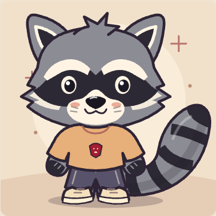
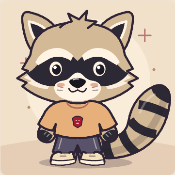
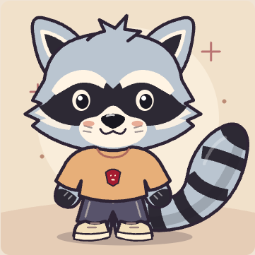
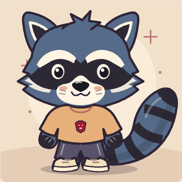
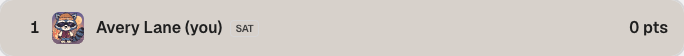

# Raccoon avatars

## Dressing room screenshots

| Viewport | Light | Dark |
| --- | --- | --- |
| Desktop, 1440 px | [Light](desktop-light.png) | [Dark](desktop-dark.png) |
| Phone, 390 px | [Light](phone-light.png) | [Dark](phone-dark.png) |

The screenshots use a local test account. The phone captures show the entire scrollable page with the fixed tab bar placed at the bottom of the image.

## Default mascot and six fur colors

| Classic Gray (default) | Charcoal | Cream |
| --- | --- | --- |
|  |  |  |

| Cinnamon | Frost | Midnight |
| --- | --- | --- |
|  |  |  |

## Six sample outfits

| Library Night | Relay Captain | Crimson Graduate |
| --- | --- | --- |
|  |  |  |

| Art Club | Rooftop Radio with Sunglasses and Galaxy Swirl | Campus Stroll |
| --- | --- | --- |
|  |  |  |

## Leaderboard avatar at 32 px

## Coin pricing

The game selects three daily quests from its daily pool and pays 5 Coins for each one completed. The three weekly quests each pay 30 Coins. They require 150 points, eight lessons, and three practice sessions respectively. Each unit chest adds 20 Coins once per unit. [Daily quest selection](../../supabase/migrations/0002_gamification_mock_admin.sql) · [Quest rewards and weekly goals](../../supabase/migrations/0007_pages_shop_drills.sql) · [Unit chests](../../supabase/migrations/0006_learning_path.sql)

The active-week estimate assumes studying five days, completing two quests per study day, and meeting all three weekly goals. That gives `5 × 2 × 5 + 3 × 30 = 140 Coins/week`, or 20 Coins per calendar day on average. Actual earnings arrive in chunks as quests complete. One-time chests are excluded from this recurring estimate.

| Rarity | Standard price | Time at 140 Coins per week |
| --- | ---: | ---: |
| Common | 50 | 2.5 calendar days |
| Rare | 120 | 6 calendar days |
| Epic | 300 | 2.14 weeks |
| Legendary | 700 | 5 weeks |

The Graduation Cap (100), Reading Glasses (60), and Bow Tie (40) retain their previous prices. All six fur colors, six fur styles, and five expressions are free, as are the starter tee, joggers, and sneakers. The four purchasable auras use the standard rarity prices. The champion aura is reserved for the future weekly crown award and is outside the purchase and equip catalog.

## Database rollout

Apply [0013_raccoon_avatars.sql](../../supabase/migrations/0013_raccoon_avatars.sql) after 0012 and before deploying the raccoon client. The migration keeps all paid IDs and prices. Reading Glasses retains its `glasses` ID and moves to Eyewear, so it can be worn with a scarf or another accessory.

The client renders previously saved human outfits with the matching fur color and style. `set_avatar_outfit` accepts those older outfits and saves them in the new format. The fixed six-color palette carries over the closest coat and omits the old custom hair tint. The legacy profile fields, inventory, and RPC signatures stay compatible with the live site.
